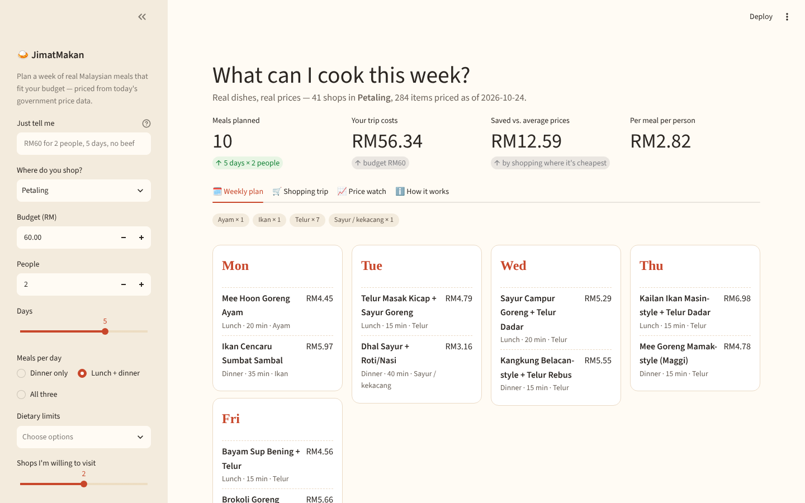
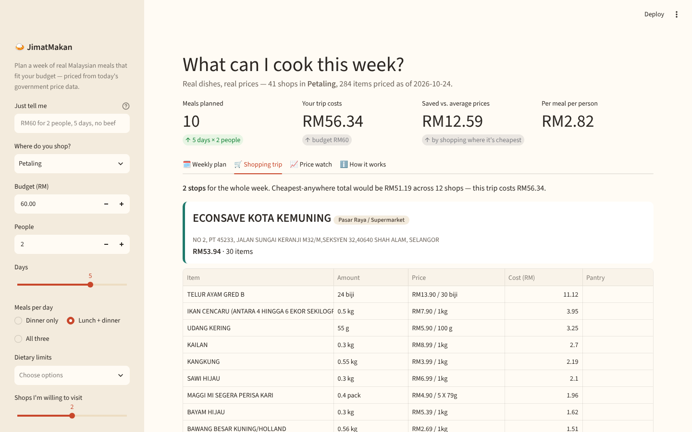
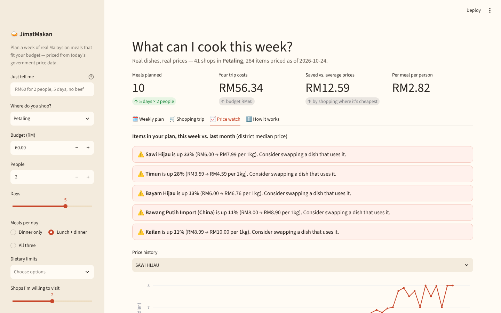

# 🍛 JimatMakan — *"What can I cook this week for RM50?"*

A budget meal planner for Malaysian students and families, powered by the
government's **real, daily-collected grocery prices** (KPDN PriceCatcher via
OpenDOSM). Tell it your budget, how many people, how many days and what you
don't eat — it optimises a week of everyday Malaysian dishes against today's
prices near you, then turns that into a shopping trip to one or two shops.

Built for **NextSpark Hacks 2026** (21–26 Oct 2026). **Live demo: https://jimatmakan.streamlit.app**



## The problem

Grocery prices in Malaysia move week to week, and the people hit hardest —
students, B40 families — plan meals by guesswork. The government already
sends officers into >1,000 shops and collects **over 2 million prices a
month**, but it publishes them as raw parquet files that almost nobody uses.
The official PriceCatcher app answers *"where is this item cheapest?"*;
nobody answers *"what can I actually cook this week for the money I have?"*

## What it does

| Step | What happens |
|---|---|
| **Price engine** | Loads the latest PriceCatcher snapshot (≈560k observations for Klang Valley), keeps each shop's last 14 days, and computes the cheapest + median price of every ingredient in your district. |
| **Recipe bank** | 29 everyday Malaysian dishes (ayam masak kicap, asam pedas, dhal, kangkung belacan…), every ingredient hand-mapped to a PriceCatcher `item_code` with realistic quantities — so each dish has a true cost *today*. |
| **Optimiser** | An integer linear programme (SciPy/HiGHS) picks one dish per meal slot to maximise vegetable content and variety (distinct dishes, distinct proteins) subject to your budget; no dish more than twice. Solves in <1 s. |
| **Shopping trip** | A greedy coverage search converts the cheapest-anywhere list into a realistic trip to ≤ *N* shops (with addresses), and re-solves the plan if the real trip breaks the budget. |
| **Price watch** | Flags any ingredient in your plan that moved ±10 % vs. last month, with a 60-day price chart, so you can swap a dish before you shop. |
| **"Just tell me"** | Type *"RM60 for 2 people, 5 days, no beef"* (English or Malay) — a small rule-based parser fills the form. No API keys needed. |




## Run it

```bash
git clone https://github.com/ShermaineYap/NextSpark-Hack
cd NextSpark-Hack
pip install -r requirements.txt
streamlit run app.py
```

The repo ships with a data snapshot (`data/`, Sep–24 Oct 2026, Klang Valley)
so it runs offline. To refresh with the newest prices or add other states:

```bash
python scripts/fetch_data.py                          # latest 2 months, KL/Selangor/Putrajaya
python scripts/fetch_data.py --months 3 --states Selangor Johor Penang
```

Tests: `python -m pytest -q`

## Project layout

```
app.py                 Streamlit UI
jimat/pricing.py       snapshot loading, district prices, trends, unit parsing
jimat/recipes.py       recipe bank mapped to PriceCatcher item codes
jimat/planner.py       recipe costing, ILP optimiser, store consolidation
jimat/ask.py           plain-language input parser
scripts/fetch_data.py  downloads + filters OpenDOSM parquet into data/
data/                  committed snapshot (items, premises, prices, meta)
tests/                 pytest suite
```

## Honest limits

- Prices are the latest *observed* by KPDN officers (usually within the last
  few days), not live shelf prices, and premises can be a few km apart within
  a district.
- Recipe quantities are home-cook approximations for 2 servings, scaled linearly.
- PriceCatcher doesn't track ikan bilis, belacan or tofu; dried prawn stands
  in for ikan bilis and those dishes are labelled "-style".
- Staples (rice, oil, sauces) are costed at the fraction used, not the pack price.

## Credits

- **Data:** [KPDN PriceCatcher via OpenDOSM](https://open.dosm.gov.my/data-catalogue/pricecatcher), CC BY 4.0.
- **Libraries:** Streamlit, pandas, PyArrow, SciPy (HiGHS MILP), Plotly.
- **AI assistance:** This project was built in a single session with Claude
  (Anthropic) acting as the engineer, directed by me. I chose to enter, set
  the brief (research the hackathon, propose a winning idea, then build it),
  and made the product calls along the way; Claude researched the hackathon
  and the OpenDOSM dataset, proposed JimatMakan, and generated the data
  pipeline, recipe-to-item mapping, ILP optimiser, Streamlit UI, tests, and
  this write-up. I reviewed, ran, and own the result, and can walk through
  how every module works (see `EXPLAIN.md`).
